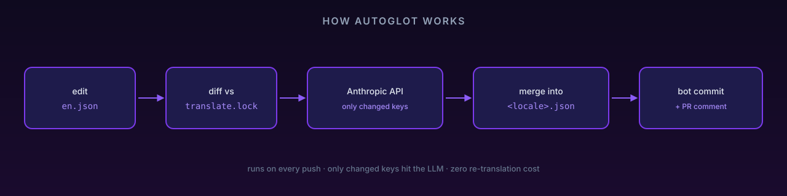

<h1 align="center">autoglot</h1>

<p align="center"><strong>One source catalog. Translations that keep up with your code.</strong></p>

<p align="center">
  
</p>

<p align="center">
  <a href="https://www.npmjs.com/package/autoglot"></a>
  <a href="https://github.com/ffcabbar/autoglot/actions/workflows/ci.yml"></a>
  <a href="https://github.com/ffcabbar/autoglot/tree/v1"></a>
  <a href="LICENSE"></a>
</p>

<p align="center">
  <a href="#quickstart">Quickstart</a> ·
  <a href="#how-it-works">How it works</a> ·
  <a href="#configuration">Configuration</a> ·
  <a href="#cli-flags">CLI reference</a>
</p>

autoglot translates JSON message catalogs with Claude. Edit your source locale, then run the CLI or let the GitHub Action commit the updated translations to your branch. Your runtime library, such as [next-intl](https://next-intl.dev/), [react-i18next](https://react.i18next.com/), or [Vue I18n](https://vue-i18n.intlify.dev/), reads the resulting files.

- **Incremental.** A committed lock file tracks source strings. autoglot translates new, changed, and missing keys and removes orphaned entries.
- **Runs where you work.** Use Node.js 20+ locally or in CI. The CLI has zero runtime dependencies and sends translation requests to Anthropic with your API key.
- **Reviewable.** The GitHub Action commits JSON changes and can post token usage and estimated cost on an open PR.

## Quickstart

Run this in your app directory and choose your target locales.

```bash
npx autoglot init
```

Review the generated files, install the suggested i18n library, and add `ANTHROPIC_API_KEY` to your GitHub repository secrets. Edit `messages/en.json` and push your branch. For a local preview of the translation plan, run `npx autoglot --dry-run`.

### Non-interactive setup

The repository source supports unattended setup. From your app directory, pass a comma-separated list of target locales to the CLI in your local Autoglot checkout.

```bash
node /path/to/autoglot/bin/cli.mjs init --locales=de,pt-BR
node /path/to/autoglot/bin/cli.mjs --dry-run
```

Setup creates the missing files and skips paths that already exist. The dry run lists the keys to translate for `de` and `pt-BR` without an API key. Add `--install` to opt into installing the runtime libraries. If that install fails, unattended setup exits with an error after printing the retry command.

### Supported frameworks

| Framework | Runtime library | What `init` scaffolds |
|---|---|---|
| **Next.js (App Router)** | `next-intl` | `src/i18n/routing.ts`, `src/i18n/request.ts`, `src/middleware.ts`, plus a starter `src/app/[locale]/layout.tsx` + `page.tsx` if no `[locale]` segment exists. [Runnable example](./examples/nextjs) |
| **Next.js (Pages Router)** | `next-i18next` | Messages + workflow only; prints precise wiring steps (next.config.js i18n block, `appWithTranslation` HOC, `serverSideTranslations` in pages) |
| **Expo** | `i18next` + `react-i18next` + `expo-localization` | `src/i18n/index.ts` with device-locale auto-detect on app start |
| **React Native (bare)** | `i18next` + `react-i18next` | `src/i18n/index.ts` with all locales registered |
| **Vite + React** | `i18next` + `react-i18next` | `src/i18n.ts` |
| **Vue / Nuxt** | `vue-i18n` | `src/i18n.ts` (Composition API mode) |
| **Generic / unknown** | (your choice) | Messages + workflow only — pair with any i18n library that reads JSON |

Install the runtime package and configure the GitHub secret.

```bash
# 1. Install the runtime i18n library — or let init do it:
npx autoglot init --install            # detects npm/yarn/pnpm/bun automatically
# (or run manually, e.g.: npm install next-intl)

# 2. Add your Anthropic API key as a repo secret
gh secret set ANTHROPIC_API_KEY

# 3. Edit messages/en.json with real strings, then push.
```

## Other commands

```bash
npx autoglot                     # run translation (the default; same as before)
npx autoglot init                # interactive scaffold (above)
npx autoglot init --install      # …and auto-install runtime libs (--pm=pnpm to override)
npx autoglot add tr ja zh        # add new target locales (creates empty JSON files)
npx autoglot doctor              # health check the setup
npx autoglot extract             # scan source for hardcoded strings and suggest keys
npx autoglot extract --write     # …and merge them into messages/en.json (existing keys protected)
npx autoglot --help              # full flag list
```

### Monorepo

Keep `translate.config.json` next to each app’s catalog. Translation, `add`, and `doctor` look for the config in the current directory and its parents. To select an app from the repository root, pass `--config=apps/mobile/translate.config.json`. Paths inside the config are relative to the config file. Keep GitHub workflows in the repository root’s `.github/workflows/` directory.

## Quickstart — GitHub Action (manual setup)

Copy this workflow to `.github/workflows/translate.yml` to set up the Action by hand.

```yaml
# .github/workflows/translate.yml
name: translate
on:
  push:
    branches: ["**"]
    paths:
      - messages/en.json
      - translate.config.json

concurrency:
  group: translate-${{ github.ref }}
  cancel-in-progress: true

jobs:
  translate:
    runs-on: ubuntu-latest
    permissions:
      contents: write
      pull-requests: write
    steps:
      - uses: actions/checkout@v4
      - uses: ffcabbar/autoglot@v1
        with:
          anthropic-api-key: ${{ secrets.ANTHROPIC_API_KEY }}
```

Add `ANTHROPIC_API_KEY` to your repo secrets, drop a `messages/en.json`, create one empty `messages/<locale>.json` per language. On every push the bot will diff, translate, commit the diff back, and post a cost summary.

### Want it to run on pull requests instead?

Switch the trigger to `pull_request` and tell `actions/checkout` to use the PR's source branch. The job below runs on pull requests from branches in the same repository.

```yaml
on:
  pull_request:
    paths:
      - messages/en.json

jobs:
  translate:
    runs-on: ubuntu-latest
    if: github.event.pull_request.head.repo.full_name == github.repository
    permissions:
      contents: write
      pull-requests: write
    steps:
      - uses: actions/checkout@v4
        with:
          ref: ${{ github.head_ref }}   # ← required for pull_request runs
      - uses: ffcabbar/autoglot@v1
        with:
          anthropic-api-key: ${{ secrets.ANTHROPIC_API_KEY }}
```

The action detects pull_request events automatically and pushes translations to the PR's source branch. If you forget the `ref:` line, autoglot prints an error explaining how to fix it instead of silently doing the wrong thing.

## Quickstart — CLI (no GitHub)

```bash
npm install -D autoglot
npx autoglot --dry-run
npx autoglot       # Set ANTHROPIC_API_KEY in your environment first
```

Works in any CI (GitLab, CircleCI, Jenkins) or on your laptop.

## vs. the alternatives

| | **autoglot** | Languine | Lokalise / Crowdin / Phrase | i18n-ai-translate |
|---|:---:|:---:|:---:|:---:|
| License | **MIT** | AGPL-3.0 | Proprietary | MIT |
| SaaS account required | **No** | No (CLI) | **Yes** | No |
| Hosted dashboard | None | Optional | Required | None |
| GitHub Action | **Yes (built-in)** | Yes | Plugin | No |
| Bot commits the diff back | **Yes** | Yes | Manual | No |
| Cost per ~1k-key PR | **<$0.01** | <$0.01 | $5–$50 | <$0.01 |
| Dependencies | **0** | many | n/a (SaaS) | several |
| Multi-provider | v0.2 | Yes | n/a | Yes |
| Formats | JSON | 15+ | 15+ | JSON |
| Self-hosted | **Yes** | Yes | No | Yes |

## Configuration

`translate.config.json` (optional — sensible defaults):

```json
{
  "source": "messages/en.json",
  "messagesDir": "messages",
  "lockFile": "translate.lock",
  "model": "claude-haiku-4-5",
  "glossary": ["MyApp", "Stripe", "API"],
  "namespaceContext": {
    "checkout": "Payment checkout form copy.",
    "dashboard": "Merchant dashboard navigation and forms."
  },
  "namespaces": {
    "dashboard": ["es", "de"]
  }
}
```

| Field | Default | What it does |
|---|---|---|
| `source` | `messages/en.json` | Path to your source-of-truth locale file. |
| `messagesDir` | `messages` | Where the other `<locale>.json` files live. |
| `lockFile` | `translate.lock` | Where to store md5 fingerprints. Commit it. |
| `model` | `claude-haiku-4-5` | Anthropic model. Haiku is recommended; quality is excellent. |
| `glossary` | `[]` | Product/brand names the model must keep verbatim. |
| `namespaceContext` | `{}` | Hint the model about each top-level namespace. Improves quality. |
| `namespaces` | `{}` | Map namespaces to their target locale lists. Other namespaces go to all target locales. |

## CLI flags

```
--check                 Exit 1 when translation updates are pending. No API call.
--dry-run               Preview the translation plan without updating catalogs.
--quiet                  Suppress per-locale and per-chunk progress. CI keeps verbose logs.
--locales=de,fr          Restrict run to specific locales.
--model=<id>             Override the configured model.
--source=<path>          Override config.source.
--messages-dir=<path>    Override config.messagesDir.
--lock-file=<path>       Override config.lockFile.
--config=<path>          Custom config file path.
--import-languine[=path] Seed the lock file from languine.lock.
--summary-path=<path>   Write the Markdown translation summary here.
-v, --version            Print version and exit.
-h, --help               Print help and exit.
```

## Models and cost

| Model | Cost (per 1M tokens) | When to use |
|---|---|---|
| `claude-haiku-4-5` *(default)* | $1 in / $5 out | General translation |
| `claude-sonnet-4-6` | $3 in / $15 out | Copy that needs more nuance |
| `claude-opus-4-7` | $5 in / $25 out | Longer or more complex copy |

Cost depends on the catalog, target locales, and token usage. See [Anthropic’s pricing](https://platform.claude.com/docs/en/about-claude/pricing) for current rates.

## Migrating from Languine

```bash
npx autoglot --import-languine=languine.lock
npx autoglot --dry-run
```

Keep your existing locale files and review the dry-run output before replacing the Languine workflow. Missing translations and strings that changed since the imported hashes will appear in the plan.

## How it works

<p align="center">
  
</p>

1. **Flatten** your source JSON to dotted keys: `{ "checkout.cta": "Pay now" }`.
2. **Diff** each value's md5 against the lock file → `new`, `changed`, `orphan` (deleted) keys.
3. **For each locale**: collect missing + changed keys, chunk into batches of 200, call Anthropic with forced [tool use](https://docs.anthropic.com/en/docs/build-with-claude/tool-use) so the response is structured JSON (not freeform).
4. **Validate** placeholders (`{name}`) match between source and translation; retry on mismatch.
5. **Merge** translations back into the locale's JSON, preserving source key order, dropping orphan keys.
6. **Update** the lock file, write a markdown summary, exit.

In CI, the action then commits the diff and posts the cost summary on the PR.

## FAQ

<details>
<summary><strong>Does it work with my framework?</strong></summary>

Yes. `npx autoglot init` has explicit support for **Next.js (App Router & Pages Router)**, **Expo**, **React Native (bare)**, **Vite + React**, and **Vue / Nuxt** — it scaffolds the right runtime setup for each. For anything else (Astro, SvelteKit, Solid, plain HTML, native mobile, server-side, ...) `init` runs in generic mode and just creates the messages + workflow; pair with whichever i18n library you already use that reads JSON.

</details>

<details>
<summary><strong>What about ICU plurals, dates, gender?</strong></summary>

ICU syntax (`{count, plural, one {# day} other {# days}}`) is preserved by the system prompt to Claude. The placeholder validator covers `{name}` tokens; ICU structure is handled by the model and should be reviewed in the resulting JSON.

</details>

<details>
<summary><strong>Why JSON only?</strong></summary>

JSON covers ~95% of JS app i18n. Adding YAML / `.strings` / Android XML triples the test surface. We'd rather do JSON well than 15 formats badly. v0.3+ if there's demand.

</details>

<details>
<summary><strong>Why not OpenAI / Gemini?</strong></summary>

The current release supports Anthropic. Follow the [roadmap](ROADMAP.md) for provider plans.

</details>

<details>
<summary><strong>Is the bot a "real" GitHub bot with an avatar?</strong></summary>

The Action writes commits as GitHub’s built-in `github-actions[bot]` account.

</details>

<details>
<summary><strong>Can I run it without GitHub?</strong></summary>

Yes. `npx autoglot` works in any CI (GitLab, CircleCI, Jenkins, your laptop). The GitHub Action is just a thin wrapper that adds the `git commit` + `gh pr comment` ritual.

</details>

<details>
<summary><strong>How do I keep brand names from being translated?</strong></summary>

Add them to `glossary` in `translate.config.json`. They'll be passed to Claude with explicit instruction to leave them verbatim.

</details>

## Roadmap

- [x] **v0.1** — Anthropic, JSON, GitHub Action, Languine importer, parallel locales, lock file
- [ ] **v0.2** — Multi-provider (OpenAI, Gemini), provider-fallback chain
- [ ] **v0.3** — YAML / `.strings` / Android XML formats (gated on demand)
- [ ] **v0.4** — Hosted GitHub App (real bot avatar, one-click install) — paid tier, OSS still first-class

See the [roadmap](ROADMAP.md) for upcoming work and the [open issues](https://github.com/ffcabbar/autoglot/issues) for current maintenance tasks.

## Contributing

Issues, PRs, and bug reports welcome. The codebase is intentionally tiny:

- `bin/translate.mjs` (≈ 500 lines) — the entire engine
- `bin/helpers.mjs` — pure helpers
- `tests/helpers.test.mjs` — `node:test` suite, runs offline

```bash
git clone https://github.com/ffcabbar/autoglot
cd autoglot
npm test                                    # offline
cd examples/basic && node ../../bin/translate.mjs --dry-run
```

## Sponsor

If `autoglot` saves you the cost of a Languine subscription, consider [sponsoring on GitHub](https://github.com/sponsors/ffcabbar). The whole project is one person's evenings.

## License

[MIT](./LICENSE) © ffcabbar

---

<p align="center">
  <sub>If autoglot helped you, a ⭐ on the repo is the best way to say thanks.</sub>
</p>
